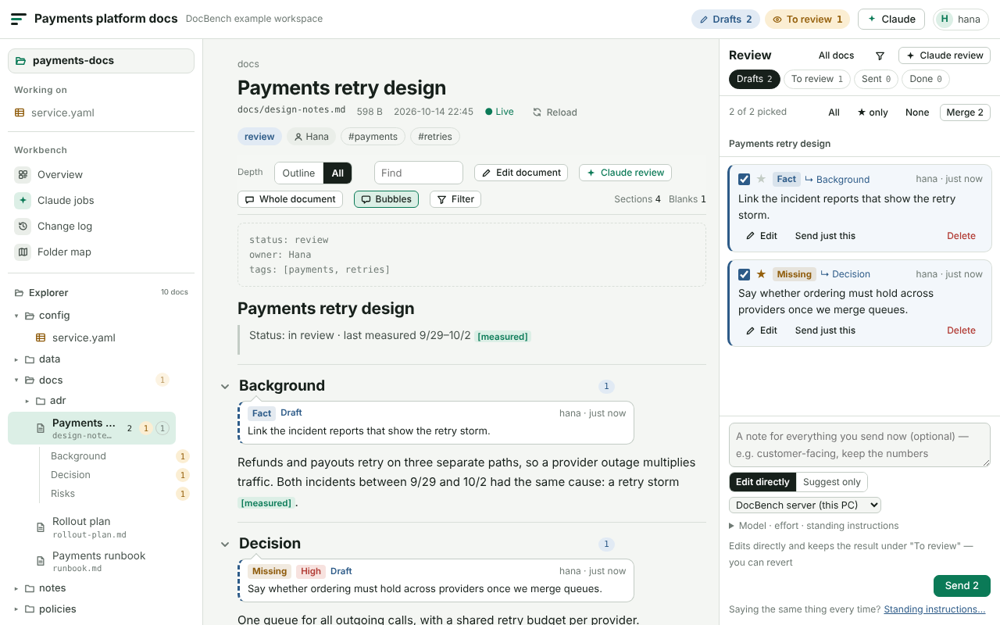
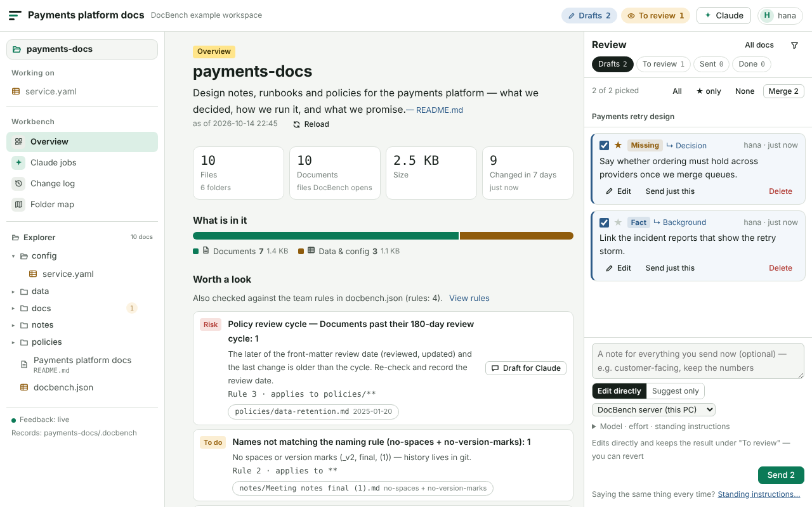
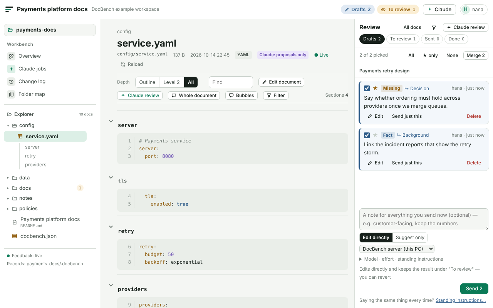

# DocBench

[한국어](README.md) · **English**

A workbench where people and AI **read, review, fix and keep a record of** the same documents — and a one-screen picture of the **workspace** those documents live in.



Documents that AI agents read and write — design notes, runbooks, ADRs, `CLAUDE.md`, policies — still need a human to review them, and the folders they live in drift (`final (1).docx`, stale policies, broken links, folders nobody can explain). DocBench is built around three ideas:

- **Review in place, send once.** Read, jot feedback next to a section or a quote as **drafts**, then send the batch with one note. What Claude did comes back as a **to-review** list — keep it, revert it, or ask again. Nothing is sent per comment.
- **The file is the source of truth.** Documents stay plain files in your folder. Saves re-encode only when the original bytes come back unchanged (UTF-8 with or without BOM, UTF-16, CP949, CRLF), every write compares versions, and the history is readable JSON.
- **The workspace has a purpose.** The first screen says what the workspace is for, what is in it, and what needs attention — including **team rules** you write in `docbench.json` and run in CI.

## What you get

- **Workspace overview** — purpose (top README or team rules), folder roles, composition by kind (docs · data & config · code · office · images · PDF …), front-matter metadata (status · owners · tags · dates — click a value to list those documents), AI collaboration files (`CLAUDE.md`, `AGENTS.md`, skills, prompts), and **worth a look**: files that look like secrets (by name only — contents are never opened), version copies (`_v2`, `final`, `(1)`), temp files, broken links, overdue reviews, folders without a README … Fix-it actions where they make sense: create a README, or leave drafts for Claude.
- **Team rules and CI** — put conventions in `docbench.json` (front-matter keys and allowed values, folder READMEs, naming, review cycles, forbidden files, size limits, required files). The overview checks them, and `docbench check` runs the same checks in CI with PR annotations. See [Team rules and CI](#team-rules-and-ci).
- **Many formats** — Markdown; YAML · JSON · TOML · INI (each key is a section); AsciiDoc · reStructuredText · Org; text, logs and code (highlighted, line numbers); CSV · TSV (tables); HTML (sanitised reading view) · SVG · images; Word · PowerPoint · Excel · Hangul HWPX · Jupyter (text extracted for reading and feedback); PDF. Claude may only **propose** changes to config and code, and never rewrites office originals — see [Formats](#formats).
- **Reading** — fold by heading depth (remembered), evidence chips (`[measured]` `[estimated]` `[unverified]` …), highlighted blanks (`TODO`, `TBD`), find, outline. The explorer reads only the folders you expand, so opening a whole drive stays fast.
- **Two-way with Claude** — besides fixing what you sent, Claude can **review first** (suggestions and questions before you read) or give a **reading guide** for long documents. Runs happen in the background through the DocBench app on your PC (model and effort selectable, live log), or with **one terminal line** in the Claude Code you already use — nothing to install.
- **Editing and history** — section editing with preview and diff; if someone changed another section meanwhile, your edit is re-applied, and the same section is never overwritten. What changed since you last looked is marked in the text (who and when), with per-section history, a diff against `git HEAD`, and changes made outside DocBench (editor, terminal) picked up within seconds.

The UI is in Korean and English — the app and the single HTML follow the browser language, `docbench serve` takes `?lang=en`.

## Ways to run it

| | When | How |
|---|---|---|
| **Single HTML (no server)** | Nothing to install | Open [`release/docbench.html`](release/docbench.html) in Edge or Chrome → **Open folder**. Viewing creates nothing; the first save asks once where to keep records |
| **DocBench app** | Several folders on this PC, Claude runs | `docbench app --open` — one small local service per PC. Browse and add folders without a picker, start at login with `--startup on` |
| **Dashboard tab** | Embed in an internal dashboard (any backend) | Load the app's `host.js` and `DocBenchHost.mount(tab, { root, key })` → [PORTING §2](docs/PORTING.md) · [examples/dashboard-tab](examples/dashboard-tab) |
| **Embedded component** | Node dashboard, same origin and auth | `<doc-bench api="/docbench/api">` + handler → [PORTING §3](docs/PORTING.md) |
| **claude.ai artifact** | Share and comment without a local setup | `createArtifactAdapters()` → [docs/claude-artifact.md](docs/claude-artifact.md) |

Every path uses the same UI; storage, auth and AI are **adapters** ([ARCHITECTURE](docs/ARCHITECTURE.md)). The local paths share one records folder, so feedback and history carry over between them.

### Quick start

```bash
npm install                                             # builds dist/ — Node 20.11+
node bin/docbench.mjs serve examples/sample-workspace   # → http://127.0.0.1:4317/?lang=en
node bin/docbench.mjs app --open                        # or the app (opens the browser with its key)
```

The sample workspace is in Korean on purpose — it holds the tricky cases (duplicate headings, `9/29~10/2` ranges, UTF-8 BOM + CRLF, EUC-KR).

**Claude Code plugin** (two skills plus the CLI): `claude plugin marketplace add d-j-lee/docbench` → `claude plugin install docbench@docbench` — `docbench-setup` wires DocBench into a dashboard or folder, `docbench-feedback` processes feedback from the terminal.

## Team rules and CI



Write the workspace's conventions in **`docbench.json`** at the top of the docs folder. It is a document people own and share through git — DocBench only reads it (the overview's **Create rules file** gives you a starting template, and `$schema` gives editor completion).

```json
{
  "$schema": "https://raw.githubusercontent.com/d-j-lee/docbench/main/docs/docbench.schema.json",
  "ignore": ["archive/**"],
  "checks": { "stale-docs": "off" },
  "rules": [
    { "kind": "front-matter", "paths": "docs/**", "keys": ["owner", "status"], "values": { "status": ["draft", "review", "approved"] } },
    { "kind": "readme", "paths": "*", "minFiles": 3 },
    { "kind": "naming", "paths": "docs/**", "style": ["kebab-case", "no-version-marks"] },
    { "kind": "review", "paths": "policies/**", "days": 180, "level": "risk" },
    { "kind": "forbid", "paths": ["**/*.docx"], "hint": "Convert to Markdown so git can diff it" },
    { "kind": "max-size", "paths": "**/*.{png,jpg}", "max": "1 MB" },
    { "kind": "require", "paths": ["README.md", "CHANGELOG.md", "docs/adr/"] }
  ]
}
```

| Rule | Checks |
|---|---|
| `front-matter` | Markdown front matter has `keys`, and only the `values` listed |
| `readme` | These folders (`"*"` = each top folder) have a README — only folders with at least `minFiles` files |
| `naming` | Names (before the extension) follow `kebab-case` · `snake_case` · `lowercase` · `no-spaces` · `ascii` · `date-prefix` · `number-prefix` · `no-version-marks`. Conventional names (README, LICENSE …) are skipped |
| `review` | Looked at within `days` — the later of the front-matter review date (`reviewed`, `updated` …) and the last change (git commit, else file time). With `field`, only that date counts |
| `forbid` · `max-size` · `require` | Files or folders that should not be here / size limit / at least one match per pattern. Inside hidden or tool folders (`.github`, `node_modules`, `dist` …) only literal paths are checked (`.github/workflows/`) |

Every rule takes `paths` and `except` (globs: `**` any folders, `*` and `?` within a name, `{a,b}`, folders end with `/`), `name`, `hint` and `level` (`risk`, `action` — default, `tidy`, `info`). `ignore` leaves paths out of every check; `checks` changes the level of a built-in check or turns it `"off"`. A broken rules file is not silently ignored — it shows up as a problem to fix.

**CI.** `docbench check` needs no records folder and writes nothing. It exits with **5** when something at or above `--fail-on` (default `action`) is found.

```bash
node docbench.mjs check docs --lang en             # human-readable (--json for machines)
node docbench.mjs check . --fail-on risk           # fail only on risk · never = report only
```

```yaml
# .github/workflows/docs.yml — annotations on the PR's files and a job summary
on: pull_request
jobs:
  docs:
    runs-on: ubuntu-latest
    steps:
      - uses: actions/checkout@v5
        with: { fetch-depth: 0 }    # review cycles use commit times (in a shallow clone every file looks changed in the last commit — check says so)
      - uses: d-j-lee/docbench@v0.10.0
        with: { path: docs, fail-on: action, lang: en }
```

This repository checks its own docs with its own Action ([`docbench.json`](docbench.json) · [CI](.github/workflows/ci.yml)).

## Formats



| Format | Shown as | Sections | People | Claude |
|---|---|---|---|---|
| Markdown | Rendered | Headings | Read · edit | Fix · propose |
| YAML · JSON · TOML · INI | Highlighted source, line numbers | Keys and tables (`server › tls`) | Read · edit | **Propose only** — tools execute these |
| AsciiDoc · reStructuredText · Org | Source | Headings | Read · edit | Fix · propose |
| Text · CSV/TSV · JSON Lines · Mermaid · PlantUML · Graphviz | Text / **table** / source | Whole document | Read · edit | Fix · propose |
| Code · HTML · XML · SVG · SQL · diff | Highlighted source / sanitised view / image | Whole document | Read · edit | **Propose only** |
| Logs | Levels (ERROR · WARN) coloured | Whole document | Read | Answer only |
| Word · PowerPoint · Excel · HWPX · Jupyter | **Extracted text** (headings, lists, tables, slides, sheets) + download original | Extracted headings | Read · feedback | Answer only |
| PDF · images | Image / download card | Whole document | Read · feedback | Answer only (Claude reads the file itself) |

Files that are plain text but read by tools or agents — dependency lists, `CODEOWNERS`, MDX, AI instruction files (`CLAUDE.md`, `AGENTS.md`, `SKILL.md` …) — are propose-only too. Files that look like secrets (`.env`, `credentials.json`, keys …) are never documents. Code is left out of the document list by default; add `"include": ["**/*"]` to the records `config.json` to include it (Claude still only proposes).

## How a Claude run stays safe

```
UI                                    DocBench app · serve (on this PC)
──                                    ─────────────────────────────────
3 drafts + a note → Send     ──▶  <records>/runs/<id>.req.json
                                     claude -p --restricted --safe-mode --permission-mode dontAsk
                                               --tools Read,Grep,Glob --add-dir <docs folder>   (run outside the docs folder)
live log                     ◀──  <records>/runs/<id>.log.jsonl
To review: diff · revert     ◀──  DocBench applies: version check · lock · encoding kept · history
```

Claude only **reads** the docs folder; DocBench does the writing under its own rules, and an edit to a section someone just changed turns into a proposal instead of overwriting. An unattended run cannot execute commands or read outside the workspace even if text in a document tries to steer it ([SECURITY](docs/SECURITY.md)). It uses your Claude Code subscription login — no API key.

## CLI

```
docbench app [--open | --detach | --status | --stop] [--startup on|off] …
docbench serve [folder] [--data records] [--port 4317] [--no-claude]
docbench init [folder] [--data records | --inside] [--claude]
docbench status [--json]
docbench fb list|show|add|reply|propose …
docbench doc list|sections|show|write|new …
docbench overview [--scope folder] [--json]
docbench check [folder] [--fail-on level] [--format text|json|github] [--rules file] [--lang en]
```

Get it from the repository (`node bin/docbench.mjs`) or as **one file**, [`release/docbench.mjs`](release/docbench.mjs) (everything but the server UI, Node 20.11+). Exit codes: 0 ok · 1 bad input · 2 workspace not found · 3 changed meanwhile (re-read) · 4 read-only · 5 check failed. Workflow details: [FEEDBACK-PROTOCOL](docs/FEEDBACK-PROTOCOL.md) (Korean).

## Development

```bash
npm run typecheck   # browser TS + server/CLI JSDoc
npm test            # unit + server/CLI
npm run test:e2e    # Chromium: npx playwright install chromium
npm run check       # everything — run before you finish
npm run release     # after changing UI or CLI: refresh release/ and the plugin CLI
node scripts/screenshots.mjs   # refresh docs/images
```

The server has zero runtime dependencies (optional `iconv-lite` for CP949); the browser bundle needs no CDN (marked, DOMPurify and jsdiff are bundled — [THIRD_PARTY_NOTICES](THIRD_PARTY_NOTICES.md)). Design notes and decisions live in [docs/](docs) — [ARCHITECTURE](docs/ARCHITECTURE.md), [DECISIONS](docs/DECISIONS.md), [SECURITY](docs/SECURITY.md), [REST contract](docs/openapi.yaml) (mostly Korean).

## License

[MIT](LICENSE) © 2026 d-j-lee.
